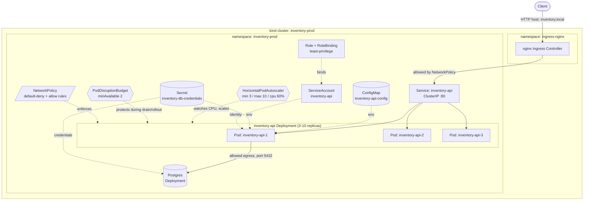

# k8s-production-lab

A small inventory REST API deployed to Kubernetes the way a real internal service would be: rolling updates with zero downtime, autoscaling under load, enforced pod disruption budgets, least-privilege RBAC, default-deny network policy, and a set of controlled failure scenarios (bad rollout, node drain, load spike) that are actually exercised against a live cluster rather than just described.

Everything in this repo runs locally against [kind](https://kind.sigs.k8s.io/). There's no cloud account or billing involved — clone it, run three scripts, and you have the same cluster state described below.

## Project goal

Most "Kubernetes portfolio" repos stop at `kubectl apply -f deployment.yaml`. The point of this one is the opposite: given a working Deployment, what does it take to run it like a production service? That means:

- Configuration and credentials handled correctly (ConfigMap vs Secret, never committed)
- The Service only sends traffic to pods that are actually ready
- A bad rollout gets caught by readiness probes and rolled back safely, without an outage
- Losing a node doesn't take the service down
- The API scales under load and scales back down when load disappears
- Network access is default-deny, with narrow, explicit exceptions
- All of the above is demonstrated against a real cluster, with real `kubectl` output, not asserted in prose

## Architecture



Request flow: a client hits `inventory.local` → the ingress-nginx controller (the only thing NetworkPolicy allows to reach the API pods) → the `inventory-api` ClusterIP Service → whichever pods currently pass their readiness probe. Each pod reads its config from a ConfigMap, its credentials from a Secret, and checks Postgres connectivity as part of readiness. The HPA and PDB both watch the same pod set from different angles: one adds/removes replicas based on CPU, the other refuses to let voluntary disruptions (drain, rollout) drop available replicas below 2.

## Repository structure

```
k8s-production-lab/
├── app/                    # FastAPI service
│   ├── main.py              # /health/live, /health/ready, /api/items
│   ├── requirements.txt
│   ├── requirements-dev.txt
│   ├── tests/
│   └── Dockerfile
├── infra/
│   └── kind-config.yaml     # 1 control-plane + 2 workers, Calico enabled
├── k8s/                     # raw manifests, applied directly (no Helm/Kustomize)
│   ├── namespace.yaml
│   ├── configmap.yaml
│   ├── secret.example.yaml  # template only, real secret.yaml is gitignored
│   ├── serviceaccount.yaml
│   ├── rbac.yaml
│   ├── postgres.yaml
│   ├── deployment.yaml
│   ├── service.yaml
│   ├── ingress.yaml
│   ├── hpa.yaml
│   ├── pdb.yaml
│   └── networkpolicy.yaml
├── scripts/
│   ├── setup-cluster.sh      # create kind cluster + Calico + ingress-nginx + metrics-server
│   ├── deploy.sh             # build image, load into kind, apply manifests
│   ├── verify.sh             # check cluster state, curl health endpoints
│   ├── load-test.sh          # generate load through the Ingress for HPA demo
│   ├── simulate-bad-release.sh  # roll out a broken readiness probe
│   ├── rollback.sh           # kubectl rollout undo + verify
│   ├── drain-node.sh         # cordon/drain a worker, observe PDB behavior
│   └── teardown.sh           # delete the kind cluster
├── .github/workflows/ci.yml
├── LICENSE
└── README.md
```

## Local cluster architecture

`infra/kind-config.yaml` defines 1 control-plane + 2 worker nodes. A single-node cluster can't demonstrate any of the scheduling, drain, or PDB behavior this project is about, so a minimum of 2 workers is the point, not an arbitrary choice.

Two things about the kind config are easy to miss and matter a lot here:

- **`disableDefaultCNI: true` + Calico.** kind's default CNI (`kindnet`) does not enforce `NetworkPolicy` at all — every policy in `k8s/networkpolicy.yaml` would apply cleanly and do nothing. `scripts/setup-cluster.sh` installs [Calico](https://www.tigera.io/project-calico/) instead, so default-deny is actually enforced (verified below, not just asserted).
- **`extraPortMappings` on the control-plane** map container ports 80/443 to host ports 8080/8443, and the node is labeled `ingress-ready=true` so the [kind-specific ingress-nginx manifest](https://kind.sigs.k8s.io/docs/user/ingress/) binds to it.

`scripts/setup-cluster.sh` brings up, in order: the kind cluster → Calico → ingress-nginx → metrics-server (patched with `--kubelet-insecure-tls`, since kind's kubelet serving certs aren't signed for a real hostname — a kind-only relaxation, never do this against a real kubelet).

## Deployment behavior

`k8s/deployment.yaml` runs 3 replicas with:

```yaml
strategy:
  type: RollingUpdate
  rollingUpdate:
    maxUnavailable: 0
    maxSurge: 1
```

`maxUnavailable: 0` means the old pod is never removed before a new, ready pod exists to replace it. `maxSurge: 1` means at most one extra pod is created at a time. Combined, a rollout adds one new pod, waits for it to pass readiness, retires one old pod, and repeats — capacity never drops below 3 during a healthy rollout. The trade-off: this needs headroom for 4 pods briefly instead of 3, and rollouts take longer than an approach that tolerates a dip in capacity.

Resource requests/limits, per pod:

```yaml
resources:
  requests: { cpu: 100m, memory: 128Mi }
  limits:   { cpu: 250m, memory: 256Mi }
```

**Requests vs limits**: the request (100m/128Mi) is what the scheduler reserves — it's the guaranteed floor and what bin-packing decisions are made against. The limit (250m/256Mi) is the ceiling: the kubelet throttles CPU above the limit and OOM-kills the container if it exceeds the memory limit. This pod is `Burstable` QoS (limits set above requests on at least one resource), not `Guaranteed` — a deliberate choice for a stateless API that has bursty-but-modest CPU needs and where losing a pod to eviction under node memory pressure is preferable to reserving 250Mi per replica that mostly sits idle.

Also on the pod spec: `topologySpreadConstraints` (see [Scheduling](#scheduling-and-availability)) and a hardened `securityContext` — `runAsNonRoot`, a fixed non-root UID, `readOnlyRootFilesystem: true`, all Linux capabilities dropped, no privilege escalation. All of this was actually run — pods came up healthy with a read-only root filesystem, no adjustments needed.

## Service routing

```yaml
apiVersion: v1
kind: Service
spec:
  type: ClusterIP
  selector: { app: inventory-api }
  ports: [{ port: 80, targetPort: http }]
```

A `ClusterIP` Service is an in-cluster load balancer over the `Endpoints`/`EndpointSlice` for pods matching `app: inventory-api` **and passing their readiness probe**. This is the mechanism, not the Ingress or the Deployment, that keeps traffic off unhealthy pods:

```
$ kubectl get endpoints inventory-api -n inventory-prod
NAME            ENDPOINTS                                                   AGE
inventory-api   192.168.114.71:8000,192.168.114.72:8000,192.168.12.5:8000   2m6s
```

During the bad-release scenario below, the new (broken) pod never appears in this list — only the three old, still-ready pods do.

## Ingress

`k8s/ingress.yaml` routes `Host: inventory.local` to the Service via the `nginx` IngressClass. Locally, this is reached at `http://localhost:8080` (see kind port mapping above) with an explicit `Host` header, since there's no real DNS:

```
$ curl -H "Host: inventory.local" http://localhost:8080/api/items
{"items":[{"id":1,"name":"widget","quantity":42}, ...],"count":3}
```

`scripts/load-test.sh` deliberately drives load through this path rather than `kubectl port-forward svc/inventory-api` — a port-forward to a Service pins the whole connection to one arbitrarily-chosen pod, which would concentrate all the CPU load on a single replica and never trigger a realistic scale-out. Going through nginx means load spreads across every pod the way real traffic would, and it exercises the same NetworkPolicy path a real client uses.

## Readiness vs liveness

Both probes hit the same container on different paths, and they mean different things to Kubernetes:

- **`/health/live`** — "is the process alive at all?" Never depends on anything external (no DB check). If this fails, **the kubelet restarts the container.** It should only fail for things a restart actually fixes: deadlock, unrecoverable internal state.
- **`/health/ready`** — "can this pod handle traffic right now?" Checks warm-up time and Postgres connectivity. If this fails, **the pod is pulled out of the Service's endpoint list, but is *not* restarted** — a container can flap between ready and not-ready indefinitely without triggering a restart, which is correct: a temporarily-unreachable database isn't a reason to bounce the process.

Conflating these two is the single most common Kubernetes probe mistake — a liveness probe that checks a downstream dependency causes a restart storm the moment that dependency has a blip, since Kubernetes will keep killing and restarting a pod that was never actually broken.

## ConfigMap vs Secret

`k8s/configmap.yaml` holds non-sensitive settings (`APP_ENV`, timeouts, Postgres host/port/db name) — safe to read, diff, and log. `k8s/secret.example.yaml` is the *template* for `inventory-db-credentials` (`POSTGRES_USER`, `POSTGRES_PASSWORD`, `DATABASE_URL`); the real `k8s/secret.yaml` is gitignored and never committed. Both are consumed identically via `envFrom` in the Deployment — Kubernetes' distinction between the two objects is about access control and intent (Secrets get slightly different treatment: not shown in `kubectl describe` by default, can be encrypted at rest, etc.), not encoding — a `Secret`'s values are base64, not encrypted, which is worth knowing before treating it as sufficient protection on its own.

Local workflow for credentials:

```
cp k8s/secret.example.yaml k8s/secret.yaml
# edit k8s/secret.yaml with real values
kubectl apply -f k8s/secret.yaml
```

`scripts/deploy.sh` looks for `k8s/secret.yaml` first and only falls back to applying the placeholder `secret.example.yaml` if it's absent (fine for this local demo, never acceptable with real credentials). In an actual production cluster, none of this would be a plaintext file applied by hand at all — it'd come from Vault, AWS Secrets Manager, or an operator like External Secrets / Sealed Secrets syncing into the cluster.

## HorizontalPodAutoscaler

```yaml
minReplicas: 3
maxReplicas: 10
metrics:
  - resource: { name: cpu, target: { type: Utilization, averageUtilization: 60 } }
behavior:
  scaleUp:   { stabilizationWindowSeconds: 0,  policies: [{ type: Pods, value: 2, periodSeconds: 30 }] }
scaleDown: { stabilizationWindowSeconds: 60, policies: [{ type: Pods, value: 1, periodSeconds: 60 }] }
```

Scale-up reacts fast (add up to 2 pods every 30s, no stabilization delay) because under-provisioning directly costs latency for users. Scale-down is deliberately slow (remove at most 1 pod per 60s, after a 60s stabilization window) to avoid flapping — removing capacity too eagerly right after a load spike just means scaling back up again a minute later.

This was run against a live cluster with `scripts/load-test.sh` (60 concurrent workers hitting `/api/items` through the Ingress for 240s):

```
poll @ 20:35:00   cpu: 8%/60%     replicas: 3
poll @ 20:35:22   cpu: 66%/60%    replicas: 3   (metric crossed target)
poll @ 20:35:43   cpu: 175%/60%   replicas: 3→5
poll @ 20:36:04   cpu: 211%/60%   replicas: 5→7
poll @ 20:36:25   cpu: 192%/60%   replicas: 7→9
poll @ 20:37:08   cpu: 167%/60%   replicas: 9→10  (hit maxReplicas)
```

Load stopped at 240s. Scale-down, one pod at a time as configured:

```
20:39:29   cpu: 100%/60%   replicas: 10   (metric hasn't dropped yet)
20:40:14   cpu:   7%/60%   replicas: 10   (load gone, waiting out stabilization window)
20:40:59   cpu:   8%/60%   replicas: 9
20:41:45   cpu:   9%/60%   replicas: 8
20:42:30   cpu:   8%/60%   replicas: 7
20:44:01   cpu:   8%/60%   replicas: 6
20:44:50   cpu:   7%/60%   replicas: 5
20:45:35   cpu:   8%/60%   replicas: 4
20:46:21   cpu:   9%/60%   replicas: 3   (back to floor)
```

Scaling isn't instantaneous for two independent reasons: metrics-server only refreshes usage every ~15-60s (so the HPA is always reacting to slightly stale data), and the `behavior` block adds a deliberate stabilization window on scale-down specifically to prevent flapping. The asymmetry between the fast scale-up and slow scale-down above is by design, not a limitation.

## PodDisruptionBudget

```yaml
spec:
  minAvailable: 2
  selector: { matchLabels: { app: inventory-api } }
```

A PDB only governs *voluntary* disruptions — `kubectl drain`, descheduler, cluster autoscaler node removal — issued through the Eviction API. It does nothing for a node that simply crashes; there's no API call to reject in that case. See [Node maintenance](#node-maintenance-scenario) below for this actually blocking an eviction in real output.

## RBAC and ServiceAccount

`k8s/serviceaccount.yaml` creates a dedicated `inventory-api` ServiceAccount (never the `default` one) with `automountServiceAccountToken: true`, and `k8s/rbac.yaml` binds it to a `Role` scoped to `get`/`watch` on exactly two named objects — its own ConfigMap and Secret — in its own namespace only:

```yaml
rules:
  - apiGroups: [""]
    resources: ["configmaps"]
    resourceNames: ["inventory-api-config"]
    verbs: ["get", "watch"]
  - apiGroups: [""]
    resources: ["secrets"]
    resourceNames: ["inventory-db-credentials"]
    verbs: ["get", "watch"]
```

The app doesn't currently call the Kubernetes API (config comes in via `envFrom` at pod start), so functionally this Role is not required today. It's here to demonstrate the pattern deliberately: an unscoped default ServiceAccount effectively has zero permissions until bound to something, but leaving that implicit doesn't scale — the moment a real reason to call the API shows up (dynamic config reload, leader election), it's much easier to widen an existing narrow Role than to notice a wildcard one should have been narrower from the start. If this pod is ever compromised, the blast radius is "read two named objects in one namespace," not "list every Secret in the cluster."

## NetworkPolicy

`k8s/networkpolicy.yaml` is default-deny plus four narrow allow rules:

1. **`default-deny-all`** — empty `podSelector` (matches every pod in the namespace), `policyTypes: [Ingress, Egress]`, no rules. NetworkPolicies are additive, so this is the baseline everything else punches a hole in.
2. **`allow-ingress-from-nginx`** — only pods in the `ingress-nginx` namespace may reach `inventory-api` pods, only on port 8000. Nothing else in the cluster, including other pods in the same namespace, can call the API directly.
3. **`allow-dns-egress`** — every pod may reach `kube-system` on UDP/TCP 53. Without this, `default-deny-all` would also block DNS lookups, since kube-dns is just another pod-to-pod connection subject to the same egress policy.
4. **Database egress**, split into two policies because NetworkPolicy enforces both ends of a connection independently — an egress allow on the source and an ingress allow on the destination are both required, or the connection is still blocked:
   - `allow-api-egress-to-postgres`: API pods may reach `postgres` pods on 5432 (egress side)
   - `allow-postgres-ingress-from-api`: only API pods may reach `postgres` pods (ingress side)

This was verified against the live cluster, not just deployed and assumed correct. First, the allowed path — the real DB-backed readiness check succeeding proves DNS egress, database egress, and the app's Secret-sourced `DATABASE_URL` are all wired correctly:

```
$ curl http://localhost:18080/health/ready
{"status":"ready","env":"production","uptime_seconds":13.38}
```

Then, the denied path — a throwaway pod with no matching labels, in the same namespace, trying to reach the API directly (bypassing the Ingress):

```
$ kubectl run netpol-test --rm -it --restart=Never --image=curlimages/curl \
    -n inventory-prod -- curl -sf --max-time 5 \
    http://inventory-api.inventory-prod.svc.cluster.local/health/live
# curl exit code 28 (operation timed out) -- connection never established
```

Same namespace, correct DNS name, correct port — and it times out, because `allow-ingress-from-nginx` only permits traffic sourced from the `ingress-nginx` namespace. That's default-deny actually being enforced by Calico, not just present in YAML.

## Scheduling and availability

```yaml
topologySpreadConstraints:
  - maxSkew: 1
    topologyKey: kubernetes.io/hostname
    whenUnsatisfiable: ScheduleAnyway
    labelSelector: { matchLabels: { app: inventory-api } }
```

This asks the scheduler to keep the pod count per node within 1 of each other, so 3 replicas across 2 schedulable workers lands close to 2/1, not 3/0. `whenUnsatisfiable: ScheduleAnyway` (rather than `DoNotSchedule`) is the important choice here: it's a *preference*, not a hard requirement. `DoNotSchedule` would leave pods `Pending` forever if the cluster temporarily has fewer nodes than replicas — which is exactly what happens during the drain scenario below, and a hard constraint would have made the drain fail instead of degrade gracefully.

Real evidence of "fewer nodes than replicas," captured during the drain scenario (see below): with one of two workers cordoned, all 3 replicas ended up on the single remaining worker. `ScheduleAnyway` let the Deployment stay fully available on 1 node instead of getting stuck; once the drained node was uncordoned, existing pods stayed put — Kubernetes doesn't rebalance already-running pods just because a preferable node reappears, only future scheduling decisions see it.

## Rolling updates, failed rollout, and rollback

`scripts/simulate-bad-release.sh` sets `FAIL_READINESS=true` on the Deployment — the app is written to unconditionally fail `/health/ready` when that's set, standing in for "the new image doesn't work." Real output from running it against the live cluster:

```
$ kubectl set env deployment/inventory-api FAIL_READINESS=true

$ kubectl rollout status deployment/inventory-api --timeout=25s
Waiting for deployment "inventory-api" rollout to finish: 1 out of 3 new replicas have been updated...
error: timed out waiting for the condition

$ kubectl get deployment inventory-api
NAME            READY   UP-TO-DATE   AVAILABLE   AGE
inventory-api   3/3     1            3           111s
```

**What Kubernetes sees**: `maxUnavailable: 0` means it created exactly one new pod and is now waiting for it to become ready before touching any old pod — which is why `AVAILABLE` stays at 3 throughout. The rollout doesn't fail outright; it just never finishes, which is the correct behavior (no automatic rollback exists in vanilla Kubernetes — the Deployment controller keeps retrying the new pod indefinitely unless something intervenes).

```
$ kubectl describe pod inventory-api-6cc46487bb-clwl2
...
Events:
  Normal   Scheduled  41s  default-scheduler  Successfully assigned ...
  Normal   Started    40s  kubelet            Container started
  Warning  Unhealthy  4s (x7 over 34s)  kubelet  Readiness probe failed: HTTP probe failed with statuscode: 503

$ kubectl logs inventory-api-6cc46487bb-clwl2
INFO:  192.168.12.0:36338 - "GET /health/ready HTTP/1.1" 503 Service Unavailable
INFO:  192.168.12.0:60182 - "GET /health/live HTTP/1.1" 200 OK
```

**Why the pod isn't ready**: the container is running fine (liveness passes — no restarts happen) but `/health/ready` returns 503 every time, so `kubectl describe` shows `Ready: False` with repeated `Unhealthy` events. **Why traffic shouldn't reach it**: it's serving 503s by design in this scenario; if it received live traffic it would either error or, in a more realistic broken-migration scenario, return wrong data. **What happens to the rollout**: the old ReplicaSet is untouched — the Service's endpoint list never includes the new pod, so the outage that "shipping a broken build" would normally cause never happens:

```
$ kubectl get endpoints inventory-api
inventory-api   192.168.114.71:8000,192.168.114.72:8000,192.168.12.5:8000
```

Three old, healthy pods — the same three from before the bad rollout — and zero new ones. Recovery with `scripts/rollback.sh`:

```
$ kubectl rollout undo deployment/inventory-api
deployment.apps/inventory-api rolled back

$ kubectl rollout status deployment/inventory-api --timeout=120s
deployment "inventory-api" successfully rolled out

$ kubectl get pods -l app=inventory-api
NAME                            READY   STATUS    RESTARTS   AGE
inventory-api-f5589cddf-7ncr9   1/1     Running   0          74s
inventory-api-f5589cddf-mnsmf   1/1     Running   0          74s
inventory-api-f5589cddf-scj57   1/1     Running   0          74s
```

`rollout undo` reverts to the previous ReplicaSet's pod template (clearing `FAIL_READINESS`), and the same `maxUnavailable: 0` rolling-update logic applies in reverse — the broken pod is torn down once a good one is ready, never before.

## Node maintenance scenario

`scripts/drain-node.sh` cordons a worker running 2 of the 3 API pods, drains it, and uncordons it. Real output:

```
$ kubectl cordon inventory-prod-worker
node/inventory-prod-worker cordoned

$ kubectl drain inventory-prod-worker --ignore-daemonsets --delete-emptydir-data
evicting pod inventory-prod/inventory-api-f5589cddf-7ncr9
evicting pod inventory-prod/inventory-api-f5589cddf-mnsmf
pod/inventory-api-f5589cddf-mnsmf evicted
evicting pod inventory-prod/inventory-api-f5589cddf-7ncr9
error when evicting pods/"inventory-api-f5589cddf-7ncr9" -n "inventory-prod" (will retry after 5s):
  Cannot evict pod as it would violate the pod's disruption budget.
[... retries every 5s ...]
evicting pod inventory-prod/inventory-api-f5589cddf-7ncr9
pod/inventory-api-f5589cddf-7ncr9 evicted
node/inventory-prod-worker drained
```

This is the PDB doing exactly its job, live: `drain` evicted the first pod immediately (3 available → 2 available, still ≥ `minAvailable: 2`), then tried to evict the second and was **refused by the API server** — evicting it would have dropped available replicas to 1, below the budget. `drain` doesn't give up; it retries every 5s. Once the replacement pod scheduled on the other worker passed its readiness probe (crossing back above 2 available), the second eviction succeeded and the drain completed.

```
$ kubectl get endpoints inventory-api
inventory-api   192.168.12.10:8000,192.168.12.5:8000
```

The Service never had zero ready endpoints during the entire drain — availability held throughout, which is what a PDB is for. The interaction with the pieces above: `cordon` stops the **scheduler** from placing new pods on the node (existing pods are untouched); `drain` then evicts existing pods one at a time, but only as fast as the **PDB** allows; `topologySpreadConstraints` with `ScheduleAnyway` let all 3 replicas land on the single remaining worker rather than getting stuck `Pending`. `kubectl uncordon` at the end makes the node schedulable again — it does not move already-running pods back.

## Autoscaling scenario

Covered in detail above under [HorizontalPodAutoscaler](#horizontalpodautoscaler): baseline 3 → sustained load pushes CPU to 100–200%+ of target → scale-out to 3→5→7→9→10 in ~2.5 minutes → load removed → gradual scale-down back to the floor of 3 over roughly 6 minutes, one pod every ~45-60s per the `behavior.scaleDown` policy. Run it yourself with:

```
./scripts/load-test.sh 240 60      # 240s duration, 60 concurrent workers
kubectl get hpa inventory-api -n inventory-prod -w
```

## Troubleshooting reference

The commands actually used above, in the order they're useful during an incident:

```
kubectl get pods -n inventory-prod -o wide          # who's running, where, how many restarts
kubectl get deployments -n inventory-prod            # READY vs UP-TO-DATE vs AVAILABLE tells the story
kubectl describe pod <pod> -n inventory-prod          # events: scheduling, probe failures, image pulls
kubectl logs <pod> -n inventory-prod                  # application-level detail
kubectl get events -n inventory-prod --sort-by=.lastTimestamp
kubectl rollout status deployment/<name> -n inventory-prod --timeout=<n>s
kubectl rollout history deployment/<name> -n inventory-prod
kubectl get endpoints <service> -n inventory-prod     # ground truth for "what's actually receiving traffic"
```

`READY` vs `UP-TO-DATE` vs `AVAILABLE` on `kubectl get deployment` is the fastest signal something's wrong: during the bad rollout above, `UP-TO-DATE` dropped to 1 while `AVAILABLE` held at 3 — the new pod exists but isn't counted as available, which is the one-line summary of the entire incident before drilling into `describe`/`logs`/`events`.

## CI

`.github/workflows/ci.yml` runs three independent jobs on every push/PR:

- **test** — installs `app/requirements-dev.txt`, runs `pytest app/tests`
- **validate-manifests** — `yamllint` on `k8s/` and `infra/`, then [`kubeconform`](https://github.com/yannh/kubeconform) `-strict` schema validation against every manifest in `k8s/` (excluding the Secret template, which has no schema-relevant content to validate beyond what kubeconform already checks)
- **build** — `docker build` on `app/Dockerfile`, confirming the image actually builds

Deliberately excluded: a `kubectl --dry-run=server` pass, which needs a live API server and would mean spinning up a cluster in CI just to validate YAML that `kubeconform` already covers structurally. The real server-side validation happens locally via `scripts/deploy.sh` against kind, which is closer to how this project is meant to be exercised anyway.

## Production limitations and trade-offs

This is a local demo, and the differences from a real production deployment are worth being explicit about rather than glossing over:

- **Postgres has no persistence or HA.** `k8s/postgres.yaml` uses `emptyDir` and a single replica — data is lost if the pod is rescheduled. A real deployment would use a managed database (RDS, Cloud SQL) or at minimum a StatefulSet with a real `PersistentVolumeClaim` and a storage class with actual replication.
- **No TLS.** The Ingress serves plain HTTP; there's no cert-manager or TLS termination configured. A real Ingress would terminate TLS with certificates from a real CA.
- **Image is local-only.** `inventory-api:local` is built and loaded directly into kind nodes (`kind load docker-image`); there's no registry, no image signing, no vulnerability scanning gate.
- **No observability stack.** No Prometheus/Grafana, no centralized logging, no tracing. The only signal available is what `kubectl` surfaces directly, which is enough for this project's scope but not for running something in anger.
- **RBAC Role is illustrative, not load-bearing.** The app doesn't call the Kubernetes API today; the Role exists to demonstrate the least-privilege pattern before it's actually needed, not because it's required for current functionality.
- **Single cluster, single "AZ."** kind runs everything as Docker containers on one machine — there's no real multi-node failure domain, no cross-zone anything. Node drain and PDB behavior generalize; physical fault-tolerance claims wouldn't.
- **No admission control / policy enforcement beyond NetworkPolicy.** No OPA/Gatekeeper, no Kyverno, no `PodSecurity` admission configured at the namespace level (the Deployment's own `securityContext` is hardened, but nothing *enforces* that other workloads in the namespace do the same).
- **HPA is CPU-only.** No custom or external metrics (queue depth, request latency), which is what most real-world autoscaling eventually needs once CPU stops being a good proxy for load.

None of this is presented as production-ready — it's a deliberately-scoped demonstration of the mechanisms, run against a real cluster with real output, rather than a claim that this exact configuration is what should run in front of real traffic.

## Running it yourself

```
./scripts/setup-cluster.sh          # kind cluster + Calico + ingress-nginx + metrics-server
./scripts/deploy.sh                 # build image, load into kind, apply manifests
./scripts/verify.sh                 # check pods/svc/hpa/pdb, curl health endpoints

./scripts/simulate-bad-release.sh   # trigger + diagnose a bad rollout
./scripts/rollback.sh               # recover

./scripts/drain-node.sh             # cordon/drain a worker, observe PDB behavior

./scripts/load-test.sh 240 60       # generate load, watch HPA scale out and back down

./scripts/teardown.sh               # delete the kind cluster
```

Requires: Docker, [kind](https://kind.sigs.k8s.io/), `kubectl`. Everything else (Calico, ingress-nginx, metrics-server) is installed by `setup-cluster.sh`.
